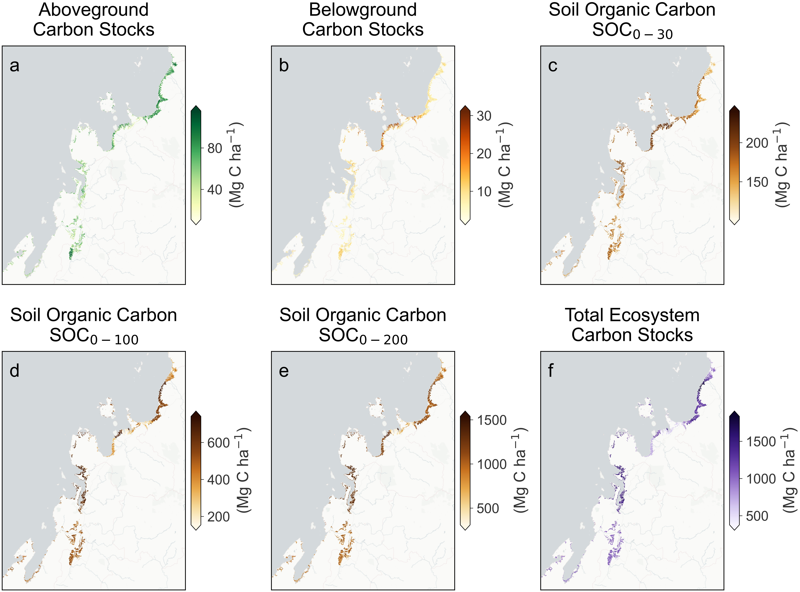
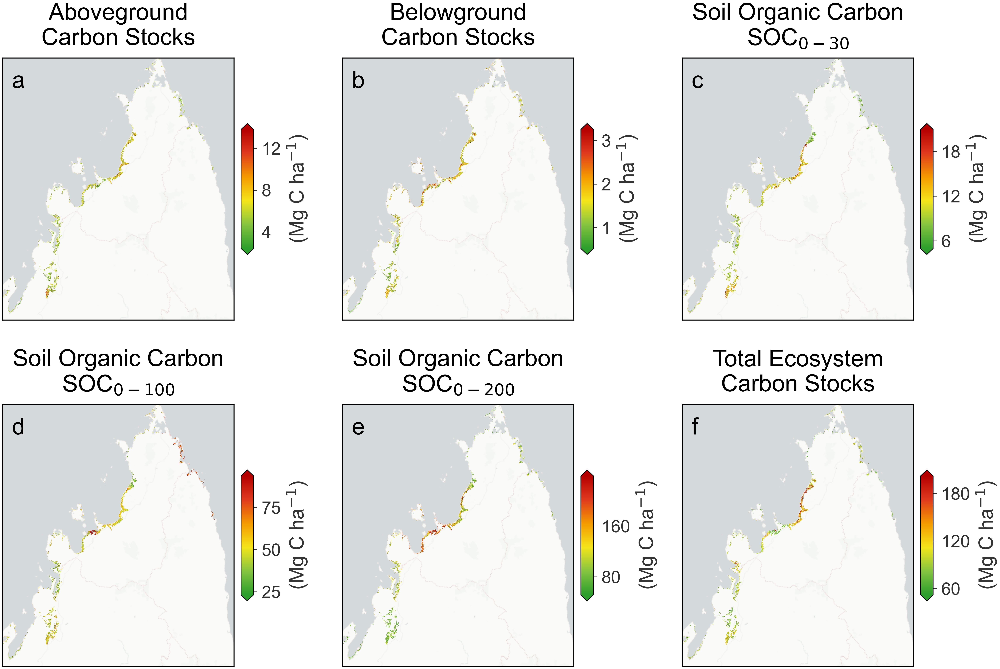

# MadaMangrove-CStocks-Mapping

This repository contains the full analytical workflow for spatially explicit estimation and uncertainty assessment of mangrove ecosystem carbon stocks across Madagascar, covering aboveground carbon (AGC), belowground carbon (BGC), and soil organic carbon (SOC) at multiple depth intervals (0–30 cm, 0–100 cm, and 0–200 cm), as well as total ecosystem carbon stocks (TECS).

## Interactive Viewer

Explore the predicted carbon stock maps interactively via the Google Earth Engine App:

**[View on Google Earth Engine](https://antsasarobidyrandria.users.earthengine.app/view/madagascar-mangrove-carbon-stocks)**

## Predicted Carbon Stocks

Spatially explicit predictions of AGC, BGC, SOC (0–30, 0–100, 0–200 cm), and TECS for Madagascar's mangroves.  The map shown here is an example for the Ambaro-Ambanja Bay (AAB) complex, Sahamalaza Bay and Loza Bay.



## Prediction Uncertainty (Standard Deviation)

Bootstrap-derived standard deviation maps quantifying prediction uncertainty for each carbon stock variable. The map shown here is an example for the Ambaro-Ambanja Bay (AAB) complex, Sahamalaza Bay and Loza Bay.



## Repository Structure

```
├── images/
│   ├── CarbonStock_Predicted_region1.jpg
│   └── CarbonStock_STD_region1.jpg
├── README.md
├── maps_prediction_code.ipynb
└── ml_modelling_code.ipynb
```

## Citation
